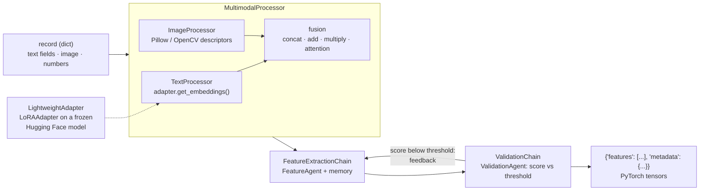

<div align="center">

# PyroChain

**Turn product records with text, images and numbers into validated PyTorch feature tensors, locally, with open models.**

[](https://pypi.org/project/pyrochain/)
[](https://pypi.org/project/pyrochain/)
[](https://pepy.tech/projects/pyrochain)
[](https://github.com/irfanalidv/PyroChain/actions/workflows/tests.yml)
[](https://github.com/irfanalidv/PyroChain/actions/workflows/codeql.yml)
[](https://github.com/irfanalidv/PyroChain/blob/main/LICENSE)
[](https://github.com/astral-sh/ruff)
[](https://mypy-lang.org/)
[](https://github.com/irfanalidv/PyroChain/blob/main/CONTRIBUTING.md)

</div>

## Why PyroChain

Feature engineering for mixed data usually means a separate script per modality, plus glue code
to check that nothing came out empty. PyroChain does it in one call: it embeds the text with a
Hugging Face model, extracts image descriptors, fuses them, scores the result with a validation
step that re-runs extraction when the score is too low, and returns plain PyTorch tensors. It
runs on your machine with open models (no API keys), keeps a JSON-serialisable record of every
step, and lets you fine-tune a small LoRA adapter on your own text so the embeddings follow your
domain.

## Features

| Area | What you get |
| --- | --- |
| **Text features** | Mean-pooled hidden states of any Hugging Face encoder or decoder (`last_hidden_state`), through the LoRA adapter |
| **Image features** | Colour statistics, brightness, edge density, texture, size from Pillow / OpenCV; dominant colours (k-means); contour-based regions |
| **Fusion** | `concat`, `add`, `multiply` or norm-weighted `attention` fusion of text and image vectors |
| **Validation** | Completeness / quality / relevance score against a threshold; low scores trigger re-extraction and re-validation |
| **LoRA adapter** | Low-rank residual layers on a frozen base model (12,288 trainable parameters at rank 8 on DialoGPT-small); next-token training, save / load |
| **Agent memory** | Feature and validation agents keep a bounded LangChain message history, saved and restored as JSON |
| **E-commerce** | `EcommerceFeatureExtractor` (price, category, brand, review, inventory features), `ProductAnalyzer` (similar items, k-means clustering) |
| **Tooling** | `pyrochain` CLI, `FeatureMetrics`, `FeatureVisualizer` (`viz` extra), typed API (`py.typed`), Python 3.10 to 3.13 |

## Install

```bash
pip install pyrochain            # or: uv add pyrochain
pip install "pyrochain[viz]"     # + matplotlib, seaborn, pandas for FeatureVisualizer
```

For a smaller CPU-only PyTorch, install it first:

```bash
pip install torch torchvision --index-url https://download.pytorch.org/whl/cpu
pip install pyrochain
```

The first run downloads the default model, `microsoft/DialoGPT-small` (about 350 MB), and the
`sentence-transformers/all-MiniLM-L6-v2` tokenizer from the Hugging Face Hub. After that,
everything runs offline.

## Quickstart

```python
from pyrochain import PyroChain, PyroChainConfig

chain = PyroChain(PyroChainConfig(device="cpu"))  # default model: microsoft/DialoGPT-small

product = {
    "title": "Wireless Bluetooth Headphones",
    "description": "Noise cancellation and 30-hour battery life.",
    "price": 199.99,
    "category": "electronics",
}
result = chain.extract_features(product, "Extract features for product recommendation")

features = result["features"][0]
print("modalities:", features["metadata"]["modalities"])
print("text features:", tuple(features["text_features"].shape))
print("validation score:", round(features["validation_score"], 2))
print(features["validation_feedback"])
```

Output:

```text
modalities: ['text']
text features: (1, 768)
validation score: 0.91
Features passed validation with a score of 0.91
```

A text-only record scores 0.91 (relevance is lower without an image); add a PIL image under
`image` and it scores 1.0. Pass a list of dicts to process a batch. This script is
[`examples/quickstart.py`](https://github.com/irfanalidv/PyroChain/blob/main/examples/quickstart.py).

## How it works



**Design decisions**

- **Local and open.** Embeddings come from any Hugging Face model with a `last_hidden_state`
  output (`PyroChainConfig(model_name=...)`); nothing calls a hosted API.
- **The adapter is in the feature path.** Text embeddings are pooled from the LoRA-adapted
  hidden states, so `train_adapter()` changes the features you extract. `lora_B` starts at
  zero, so an untrained adapter returns exactly the base-model embedding.
- **Deterministic agents.** The feature and validation agents run their LangChain tools in a
  fixed order (`SequentialToolExecutor`) and log a ReAct-style transcript to memory; they do
  not call a generative LLM. The ReAct prompt templates are exposed (`agent.agent`) if you want
  to drive them with your own LangChain model.
- **Rule-based validation.** The score is 0.3 x completeness + 0.4 x quality + 0.3 x
  relevance. An empty or all-zero feature vector fails, which triggers one refinement pass and
  a second validation.
- **Fixed-size vectors.** Text and image vectors keep their size whether or not a modality is
  present (missing ones are zeros), so every record in a batch stacks into one matrix.

<details>
<summary>Module map</summary>

```text
pyrochain/
├── core.py           PyroChain, PyroChainConfig
├── adapters/         LightweightAdapter, LoRAAdapter, LoRALayer, BaseAdapter
├── processors/       MultimodalProcessor, TextProcessor, ImageProcessor
├── agents/           FeatureAgent, ValidationAgent, ConversationMemory, SequentialToolExecutor
├── chains/           FeatureExtractionChain, ValidationChain (memory, history, metrics)
├── utils/            EcommerceFeatureExtractor, ProductAnalyzer, ProductData,
│                     FeatureMetrics, FeatureVisualizer (viz extra)
└── cli.py            pyrochain extract | train | predict | ecommerce | init | version
```

</details>

## Use cases and examples

Runnable scripts in [`examples/`](https://github.com/irfanalidv/PyroChain/tree/main/examples),
with sample data in `examples/assets/`. No API keys; the first run downloads the model.

| Script | Use case |
| --- | --- |
| [`quickstart.py`](https://github.com/irfanalidv/PyroChain/blob/main/examples/quickstart.py) | Extract and validate features for one product record |
| [`review_sentiment_classifier.py`](https://github.com/irfanalidv/PyroChain/blob/main/examples/review_sentiment_classifier.py) | Text features into a scikit-learn sentiment classifier. On the 40 bundled reviews: 5-fold accuracy 0.88 +/- 0.14 vs a 0.50 baseline |
| [`product_catalog_similarity.py`](https://github.com/irfanalidv/PyroChain/blob/main/examples/product_catalog_similarity.py) | "Similar items" and k-means clusters from text, image, price and brand; with `all-MiniLM-L6-v2` the 8 listings cluster into audio, apparel and kitchen |
| [`listing_feature_matrix.py`](https://github.com/irfanalidv/PyroChain/blob/main/examples/listing_feature_matrix.py) | Fused text + image embeddings joined with tabular e-commerce features, saved as `.npz` |
| [`support_adapter_finetune.py`](https://github.com/irfanalidv/PyroChain/blob/main/examples/support_adapter_finetune.py) | Fine-tune the LoRA adapter on support text, then save, reload and compare embeddings |

The numbers above come from running the scripts on CPU; they are small demonstration datasets,
not benchmarks.

<details>
<summary>Recipes</summary>

`chain` is the `PyroChain` instance from the Quickstart.

**Fine-tune the adapter on your text**

```python
data = [{"text": line} for line in open("my_domain.txt", encoding="utf-8") if line.strip()]
out = chain.train_adapter(data, "domain language modelling", epochs=3, learning_rate=1e-3)
print([round(h["train_loss"], 2) for h in out["training_history"]])
chain.save_model("my_model")  # adapter weights + training history + agent memory
chain.load_model("my_model")
```

**Use a sentence-embedding model for similarity work**

```python
chain = PyroChain(PyroChainConfig(model_name="sentence-transformers/all-MiniLM-L6-v2"))
```

Mean-pooled GPT-2-family states (such as DialoGPT's) are nearly parallel for any input, so
cosine similarity between them stays close to 1.0; a sentence encoder separates texts better.

**Similar products and clusters**

```python
from pyrochain.utils import ProductAnalyzer, ProductData

analyzer = ProductAnalyzer(chain)
matches = analyzer.find_similar_products(target, catalog, top_k=3)  # [{"product", "similarity"}]
clusters = analyzer.cluster_products(catalog, n_clusters=3)  # {label: [product_id, ...]}
```

**Command line**

```bash
echo '{"title": "Organic Cotton T-Shirt", "price": 29.99}' > item.json
pyrochain extract --input-file item.json --task "product features" --output-file out.json --device cpu
pyrochain train --training-file train.json --task "domain LM" --epochs 3 --output-dir my_model
pyrochain predict --model-dir my_model --input-file item.json --task "product features"
pyrochain version
```

Every command accepts `--model` and `--device`. Tensors are written to JSON as nested lists.

</details>

## Configuration

`PyroChainConfig` (all fields optional):

| Field | Default | Meaning |
| --- | --- | --- |
| `model_name` | `"microsoft/DialoGPT-small"` | Hugging Face model used for embeddings and the adapter |
| `adapter_rank` | `16` | LoRA rank |
| `max_length` | `512` | Max tokens per text |
| `device` | `"auto"` | `auto` (CUDA, then MPS, then CPU), `cpu`, `cuda`, `mps` |
| `memory_type` | `"conversation_buffer"` | Agent memory type (bounded message buffer) |
| `enable_validation` | `True` | Run the validation agent |
| `validation_threshold` | `0.8` | Minimum score before refinement is triggered |

Other options: `LightweightAdapter.train(..., batch_size=4, validation_split=0.1, seed=None)`,
`MultimodalProcessor(fusion_method="concat", image_size=(224, 224))`.

Environment: no API keys. Standard Hugging Face variables apply, for example `HF_HOME` (cache
location) and `HF_HUB_OFFLINE=1` (never download). Training progress is reported through
`logging` (logger `pyrochain.adapters.adapter`).

## API overview

| Object | Summary |
| --- | --- |
| `PyroChain(config)` | `extract_features(data, task_description, validate=True)`, `train_adapter(...)`, `save_model(path)`, `load_model(path)` |
| `PyroChainConfig` | Configuration dataclass (table above) |
| `LightweightAdapter` / `LoRAAdapter` | `get_embeddings(text)`, `encode_text(text)`, `train(...)`, `save(path)`, `load(path)`, `get_trainable_parameters()` |
| `MultimodalProcessor` | `process(record)`, `get_features(record)`, `extract_structured_features(record)`, `get_feature_summary(record)` |
| `FeatureAgent` / `ValidationAgent` | Tool-running agents with `run(...)` and JSON memory (`save_memory`, `load_memory`) |
| `FeatureExtractionChain` / `ValidationChain` | Memory-backed orchestration, history and metrics (`get_chain_metrics`, `generate_validation_report`) |
| `EcommerceFeatureExtractor` | `extract_product_features(product, task_type)`, `extract_tabular_features(product)` |
| `ProductAnalyzer` | `analyze_product_similarity`, `find_similar_products`, `cluster_products` |
| `FeatureMetrics` | Quality, similarity, clustering, validation, training and e-commerce metrics |
| `FeatureVisualizer` | Distribution, embedding (PCA / t-SNE), clustering, training-history plots (`viz` extra) |

## Research and references

- **LoRA**: E. J. Hu, Y. Shen, P. Wallis, Z. Allen-Zhu, Y. Li, S. Wang, L. Wang, W. Chen.
  *LoRA: Low-Rank Adaptation of Large Language Models.* ICLR 2022. PyroChain uses the same
  low-rank update (`B·A` with `B` initialised to zero, scaled by `alpha / rank`), applied as a
  residual on the base model's final hidden states rather than inside the attention weights.
- **ReAct** prompt format: S. Yao et al. *ReAct: Synergizing Reasoning and Acting in Language
  Models.* ICLR 2023. The agents' prompt templates follow this format; the built-in executor
  runs the tools deterministically and does not call an LLM.
- **DialoGPT** (default model): Y. Zhang et al. *DialoGPT: Large-Scale Generative Pre-training
  for Conversational Response Generation.* ACL 2020 (System Demonstrations).

## Roadmap

- Pretrained image encoders (for example a torchvision ResNet) as an option next to the
  handcrafted image descriptors.
- Batched text embedding instead of one forward pass per record.
- LoRA inside attention projections for models that use `nn.Linear` attention layers.
- Pluggable validation rules and an optional LLM-driven agent executor.

## Contributing, security, citation, license

- Contributions are welcome: see [CONTRIBUTING.md](https://github.com/irfanalidv/PyroChain/blob/main/CONTRIBUTING.md)
  and the [Code of Conduct](https://github.com/irfanalidv/PyroChain/blob/main/CODE_OF_CONDUCT.md).
  CI runs `ruff check`, `ruff format --check`, `mypy pyrochain` and `pytest --cov` (with a tiny
  offline model) on Python 3.10 to 3.13.
- Report vulnerabilities as described in [SECURITY.md](https://github.com/irfanalidv/PyroChain/blob/main/SECURITY.md).
- To cite PyroChain, use [CITATION.cff](https://github.com/irfanalidv/PyroChain/blob/main/CITATION.cff)
  (GitHub's "Cite this repository" button reads it).
- Release notes: [CHANGELOG.md](https://github.com/irfanalidv/PyroChain/blob/main/CHANGELOG.md).
- MIT licensed: see [LICENSE](https://github.com/irfanalidv/PyroChain/blob/main/LICENSE).
